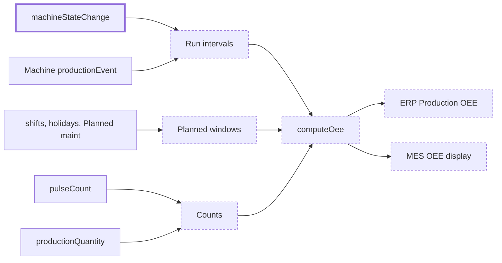

# OEE dashboard (Pulse Phase 4)

> Status: draft
> Author: Khompetch Dononsa
> Date: 2026-11-17
> Parent spec: `.ai/specs/2026-11-14-pulse-machine-monitoring.md` (Phase 4)
> Research: `.ai/research/oee-dashboard.md`

## TLDR

Carbon records when each machine runs and how many pieces it makes, but no
screen shows OEE. This spec adds 2 screens: Production → OEE in the ERP and an
OEE display per work center in the MES. One pure calculator in
`@carbon/planning/oee` computes Availability, Performance and Quality for both
apps. One migration keeps 400 days of machine state history, so the ERP can
show OEE for a past period.

## Overview diagram



## Problem Statement

Phases 1–3 record machine data, but nobody can read it as OEE:

1. A supervisor cannot see the OEE of a work center for a shift, a day or a
   month.
2. An operator at the machine cannot see how the current shift is going.
3. `util.purge_machine_state_changes()` deletes `machineStateChange` rows
   after 30 days. It also deletes the rows of a device after a user unmaps or
   remaps it. So Carbon loses the run time of a past month.

## Proposed Solution

### The calculation

All times are epoch milliseconds. All windows are half-open `[start, end)`.

| Term | Definition |
|---|---|
| Working windows | The work center's shift windows with the holidays closed. `getWorkCenterWorkingWindows` gives them. An `alwaysOn` work center works 24 hours |
| Planned stops | Each `maintenanceDispatch` with `oeeImpact = 'Planned'` on the work center, from `actualStartTime` to its end. The end is `completedAt`, else `actualEndTime`, else now while it is `In Progress` |
| Planned windows (W) | Working windows − planned stops |
| Run intervals (R) | A mapped work center: each `Running` change in `machineStateChange` until the next change on the work center, or until now. A work center with no device: the union of its Machine `productionEvent` intervals |
| Run outside shifts | \|R − W\| |
| Planned time | \|W\| + \|R − W\| |
| Run time | \|R\| |
| Down time | Planned time − Run time. A Down dispatch is part of it |
| Availability | Run time ÷ Planned time |
| Performance | Σ(ideal seconds per piece × total pieces) ÷ Run time with a standard |
| Quality | Good pieces ÷ Total pieces. Good = Total − Scrap − Rework |
| OEE | Availability × Performance × Quality |

**Ideal seconds per piece.** The calculator takes the first value it finds:

1. The `machineTime` and `machineUnit` of the `jobOperation` that owns the run.
   `Seconds/Piece`, `Minutes/Piece`, `Hours/Piece`, the `/100 Pieces` and
   `/1000 Pieces` units and the `Pieces/…` units convert to seconds per piece.
   `Total Hours`, `Total Minutes` and a `machineTime` of 0 give no standard.
2. The Pulse device: `expectedCycleSeconds ÷ piecesPerPulse`.
3. No standard. The run time and pieces of that stretch are left out of
   Performance. The screen shows "Standard coverage": Run time with a
   standard ÷ Run time.

**The owner of a run.** A stretch of run time belongs to the operation of the
Machine `productionEvent` that covers it on the work center. A stretch that
no Machine event covers has no operation. Only the device fallback (step 2)
can give it a standard. Machine events are kept for ever, so this works for
old periods too. The calculator does not read `workCenterLoad`, because `util.purge_work_center_loads()` deletes it after 7 days.

**Counts.**

| Work center | Total pieces | Scrap and Rework |
|---|---|---|
| It has a mapped Pulse device | Σ `pulses × piecesPerPulse` of the `pulseCount` rows whose `periodEnd` is in the range | Σ `scrapPulses × piecesPerPulse`, plus the Scrap and Rework `productionQuantity` rows whose `notes` does not start with `Pulse sensor ` |
| Any other work center | Σ `quantity` of the `productionQuantity` rows of all 3 types on its operations, by `createdAt` | Σ of the Scrap and the Rework rows |

The sensor writes the note `Pulse sensor <machineCountPosting.id>` on each
row it posts. The note stays after `util.purge_machine_counts()` deletes the
posting.

A `pulseCount` bucket takes the owner of the run at its `periodEnd`. A
`productionQuantity` row takes its own `jobOperationId`.

**Roll-up.** The calculator always adds the parts (times and pieces) first,
then divides. It never averages percentages. This applies to a day, a work
center, a location and the whole range.

### The ERP screen

Production → OEE (`x+/production+/oee.tsx`):

- The filters are a location and a date range. The default range is the
  last 7 days. The longest range is 92 days.
- 4 `MetricCard`s: OEE, Availability, Performance, Quality.
- A trend chart: OEE per day, in the location's timezone.
- A table with one row per active work center of the location. The columns
  are Source (Sensor or Operator), Planned time, Run time, Run outside
  shifts, Availability, Performance, Standard coverage, Quality, OEE.
- The nav item shows only while an `oee` integration is active, the same rule
  as Unattributed Time (`useProductionSubmodules`).

### The MES screen

`display+/$workCenterId.oee.tsx`, a `DisplayFrame` board that refreshes every
30 seconds:

- The period is the current shift: the working window that holds now, from
  its start to now. Between shifts, it is the shift that ended last. An
  `alwaysOn` work center uses the current local day. The times use the
  location's timezone.
- `ScoreboardRow`s: OEE, Availability, Performance, Quality, Run time, Good
  pieces, Scrap.
- The display index gets an OEE link per work center, next to the
  maintenance display link. It shows for every work center.

### Design Decisions

| Decision | Choice | Rationale |
|----------|--------|-----------|
| Run time source | `machineStateChange` for a mapped work center; Machine `productionEvent` for the others | Q1. The state changes also hold the time that went to the Unattributed Time queue. `util.purge_unattributed_machine_time()` deletes that queue after 30 days |
| History | `util.purge_machine_state_changes()` keeps rows for 400 days, also after an unmap or a remap | Q1. A remap deletes the `workCenterDevice` row, and the old purge then deleted its history. 400 days matches `util.purge_pulse_history()` |
| Storage | Compute on read. No snapshot table | Q1. A correction to a Machine event or a count shows at once. The 92-day range limit keeps the reads small |
| Ideal cycle time | Operation `machineTime`, then the Pulse device, then none | Q2. An item-specific standard gives a correct Performance on a machine that makes several items (research) |
| Run outside shifts | Added to the planned time, and shown as its own figure | Q3. Pieces made outside a shift then count in Performance and Quality, and Availability stays at or under 100 % |
| Counts on a Pulse work center | The sensor counts, plus manual Scrap and Rework | Q4. Pieces in the Unattributed Counts queue are not in `productionQuantity`. The sensor totals match the raw pulses |
| Counts elsewhere | `productionQuantity` | Q4. It is the only count source |
| Who sees the ERP screen | Users with `view: "production"`, while an `oee` integration is active | Q5. Same rule as Unattributed Time |
| Work centers on the ERP screen | All active work centers of the location, with a Source column | Q5. An operator-only work center gets an OEE too, and the Source column says how reliable it is |
| MES period | The current shift | Q6. An operator wants to see the result of the shift that is running |
| Where the math lives | `packages/planning/src/oee/` as the subpath `@carbon/planning/oee`. It imports no `@carbon/ee` code and no database client | Both apps use it, and vitest can pin it with plain data |
| Where the reads live | `packages/planning/src/oee/load.server.ts` (`@carbon/planning/oee/load.server`), with a `SupabaseClient` argument | One reader for the ERP and the MES. Both apps already read with a Supabase client |
| Window helpers | Move `getWorkCenterWorkingWindows`, `withoutOutages` and `workingHoursByDay` to `packages/planning/src/scheduling/work-center-windows.ts` | The MES needs the working windows. They are pure, and they are built from `@carbon/planning` scheduling code already |
| MES dependency | `apps/mes` adds `@carbon/planning` (workspace) | It is a workspace package, not a new production dependency |
| License | `packages/planning` and the routes are AGPL | The math reads Carbon's own tables. The paid part is the provider that fills them (`packages/ee`) |
| piecesPerPulse | The calculator uses the device's current value | `pulseCount` does not store it. See Risks |
| Heuristic 1–3: tables and RLS | No new table | The migration changes 1 function and adds 2 indexes |
| Heuristic 4: permissions | ERP: `requirePermissions(request, { view: "production" })`. MES: the same check as `$workCenterId.maintenance.tsx`, then `getDisplayWorkCenter` as the tenancy gate | Copies the siblings |
| Heuristic 5: forms | N/A | The screens have filters only, no form |
| Heuristic 6: module layout | No new module. The ERP route calls `@carbon/planning/oee/load.server`. The MES adds `getOeeDisplayData` to `display.service.ts` | Both apps share the reader, so it does not go in `production.service.ts` |
| Heuristic 7: compatibility | No public contract changes. The moved helpers keep their names and signatures | The 3 ERP call sites change their import path only |

## Data Model Changes

Migration `oee-dashboard-history.sql`:

```sql
-- Keep 400 days of machine state history for OEE, also for an unmapped device.
CREATE OR REPLACE FUNCTION util.purge_machine_state_changes()
RETURNS void
LANGUAGE sql
SECURITY DEFINER
SET search_path = public
AS $$
  DELETE FROM "machineStateChange"
  WHERE "changedAt" < NOW() - INTERVAL '400 days';
$$;

-- The OEE reads by work center and time.
CREATE INDEX IF NOT EXISTS "productionEvent_workCenterId_startTime_idx"
  ON "productionEvent" ("workCenterId", "startTime")
  WHERE "type" = 'Machine';
CREATE INDEX IF NOT EXISTS "productionQuantity_companyId_createdAt_idx"
  ON "productionQuantity" ("companyId", "createdAt");
```

`machineStateChange` already has `machineStateChange_workCenter_changedAt_idx`.
`pulseCount` already has `pulseCount_device_periodEnd_idx`. No table, column
or RLS policy changes, so `generate:types` and the authz manifest do not
change.

## API / Service Changes

`packages/planning/src/oee/` (new, AGPL):

| File | Exports |
|---|---|
| `intervals.ts` | `runIntervalsFromStateChanges`, `unionIntervals`, `intervalLength`, `subtractWindows`, `intersectWindows` |
| `standards.ts` | `idealSecondsPerPiece(machineTime, machineUnit)`, `deviceIdealSecondsPerPiece(expectedCycleSeconds, piecesPerPulse)` |
| `oee.ts` | `computeOeeParts(input)` (the sums for 1 work center and 1 period), `addOeeParts`, `oeeRatios(parts)` |
| `periods.ts` | `currentShiftPeriod(windows, now, timeZone)`, `dayPeriods(range, timeZone)` |
| `load.server.ts` | `loadOeeInputs(client, { companyId, workCenterIds, from, to })` |
| `*.test.ts` | Pins each pure file |

`oeeRatios` returns `null` for a ratio whose denominator is 0, never `NaN`.

`packages/planning/src/scheduling/work-center-windows.ts` (moved): the 3
helpers and their private helpers. `production.service.ts`,
`capacity-buckets.test.ts` and `x+/priority+/people.tsx` import them from the
new path.

`packages/planning/package.json` exports `./oee` and `./oee/load.server`.

ERP:

- `x+/production+/oee.tsx`: the page, loader reads the filters from the URL.
- `api+/production.oee.ts`: the data loader for `useLoaderQuery`. It returns
  the per-work-center parts and the per-day parts.
- `path.to.productionOee` and `path.to.api.productionOee`.

MES:

- `display.service.ts`: `getOeeDisplayData(client, { workCenterId, companyId })`.
- `display+/$workCenterId.oee.tsx` and `path.to.oeeDisplay`.

## Closest Sibling

| New | Sibling it copies |
|---|---|
| `x+/production+/oee.tsx` | `x+/production+/_index.tsx` (cards, chart, date range) and `x+/resources+/_index.tsx` (the work center table) |
| `api+/production.oee.ts` | `api+/production.kpi.$key.ts` |
| `display+/$workCenterId.oee.tsx` | `display+/$workCenterId.maintenance.tsx` |
| The OEE link on `display+/_index.tsx` | The maintenance display link on the same page |

Deviations:

- The ERP page has a location filter. The production dashboard has none,
  because OEE needs one timezone for the days and the shifts.
- The ERP page shows only while an `oee` integration is active.

## UI Changes

- ERP: a dashboard page (archetype: the production dashboard). 4
  `MetricCard`s, a `@carbon/react/Chart` line chart, and a table.
- ERP: a nav item "OEE" in `useProductionSubmodules`.
- MES: a display board (archetype: the maintenance display).
- Every string uses Lingui. Run `pnpm lingui:extract` and `/translate`.
- An empty state shows when no work center has planned time in the range.
- A ratio with no denominator shows "—".

## Acceptance Criteria

- [ ] `pnpm --filter @carbon/planning test` passes, with these cases pinned:
      a run that crosses a shift end, a run inside a Planned dispatch, a run
      fully outside the shifts, a work center with no standard, and a
      roll-up of 2 work centers that differs from the average of their
      percentages.
- [ ] A simulated Pulse shift: 8 hours planned, 6 hours Running, 2000
      sensor pieces with an ideal of 9 s, 40 Log scrap pieces. The ERP and
      the MES both show Availability 75.0 %, Performance 83.3 %, Quality
      98.0 %, OEE 61.3 %.
- [ ] The OEE pieces of a pilot shift agree with the raw `pulseCount` totals
      within 1 %.
- [ ] After a user unmaps a device and maps it again, the ERP screen still
      shows the earlier run time of its work center.
- [ ] A `machineStateChange` row of 31 days ago survives
      `util.purge_machine_state_changes()`. A row of 401 days ago does not.
- [ ] The nav item is hidden with no active `oee` integration.
- [ ] The MES board changes to the next shift within 30 seconds of the shift
      start.
- [ ] The ERP and MES typechecks, `pnpm run lint` and
      `pnpm db:check:datasets && pnpm db:check:backups` pass.

## Risks

| Risk | Severity | Mitigation |
|------|----------|------------|
| A change to `piecesPerPulse` rewrites the counts of past periods | Med | Show the current value on the screen. A later phase can store it on `pulseCount` |
| A 92-day range over many work centers reads many rows | Med | The 2 new indexes, the range limit, and reads in chunks through `fetchAllRecords` |
| A backup holds `machineStateChange` rows whose `workCenterDeviceId` no longer exists | Low | Run `pnpm db:check:backups`. If it fails, set the remap of a missing id to keep the value |
| The 2 indexes on `productionEvent` and `productionQuantity`, which are busy tables | Med | `CREATE INDEX IF NOT EXISTS` runs once at deploy. The user approved both indexes (Q7) |
| An operation with a wrong `machineTime` gives a Performance over 100 % | Low | Show the value as it is. A value over 100 % tells the reader to fix the standard (research) |
| Run outside shifts adds to the planned time, unlike the usual reading | Low | The screen shows it as its own figure |

## Open Questions

- [x] Which data gives the run time, and how long is it kept? — **Answer:**
      `machineStateChange` for a mapped work center, Machine
      `productionEvent` for the others. Keep 400 days, also after an unmap
      or a remap. (User, 2026-11-17)
- [x] Where does the ideal cycle time come from? — **Answer:** The
      operation's `machineTime`, then the Pulse device's
      `expectedCycleSeconds ÷ piecesPerPulse`, else the stretch is left out
      of Performance and the screen shows the standard coverage. (User,
      2026-11-17)
- [x] How does run time outside a shift count? — **Answer:** It adds to the
      planned time, and the screen shows it on its own. (User, 2026-11-17)
- [x] Where do the counts come from? — **Answer:** A Pulse work center uses
      the sensor counts plus the manual Scrap and Rework. Other work centers
      use `productionQuantity`. (User, 2026-11-17)
- [x] When does the screen show, and for which work centers? — **Answer:**
      While an `oee` integration is active, for every active work center,
      with a Source column. The MES board opens for every work center.
      (User, 2026-11-17)
- [x] Which period does the MES board show? — **Answer:** The current shift.
      (User, 2026-11-17)
- [x] May the migration add the 2 indexes on `productionEvent` and
      `productionQuantity`? Both are production-critical tables (root
      `AGENTS.md`, Ask First). — **Answer:** Yes, add both. (User,
      2026-11-17)

## Changelog

- 2026-11-17: Created. Questions 1–7 resolved with the user.
- 2026-11-17: Plan `.ai/plans/2026-11-17-oee-dashboard.md`. The calculator
  finds a sensor row by its note, because `util.purge_machine_counts()`
  deletes Posted postings after 90 days.
