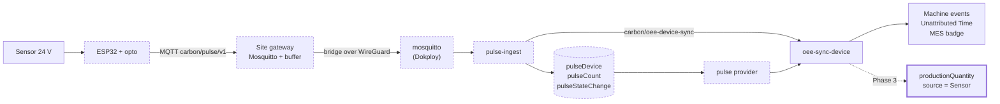

# Pulse machine monitoring

> Status: in-progress (Phase 1 built; Phases 2–4 open)
> Author: Khompetch Dononsa
> Date: 2026-11-14

## TLDR

Pulse is Carbon's own machine monitor. It does the same job as Sense, with
cheap cycle sensors. A sensor on each machine sends one pulse per cycle. An
ESP32 counts the pulses and publishes them over MQTT. The ingest service
`apps/pulse-ingest` stores the counts and infers the machine state (Running,
Idle, Offline). A new OEE provider, `pulse`, gives these states to the
existing OEE engine. Machine events, Unattributed Time and the MES state badge
then work with no change. Later phases post production quantities from the
counts and add OEE screens.

## Overview diagram

## Problem Statement

The user wants OEE screens but has no Sense devices. Carbon records machine
time only through an OEE provider, and Sense is the only one. Without a
provider, run time, idle time and the count of good parts are not recorded.

## Proposed Solution

Add a second OEE provider, `pulse`, whose data comes from Carbon's own
hardware. Reuse everything after the provider: `planMachineTime`, the
`oee-sync` jobs, the device mapping tab, Unattributed Time and the MES badge.
Build new parts only where Sense has no equivalent: the hardware, the ingest
service, and (Phase 3) automatic quantities.

The deployment changes to `CARBON_EDITION=enterprise`, because the user holds
a commercial license and the OEE engine is in `packages/ee`. This turns on
every commercial feature in `FEATURE_PLANS`, not only INTEGRATIONS.

### Design Decisions

| Decision | Choice | Rationale |
|----------|--------|-----------|
| Signal | One pulse per machine cycle from a proximity or photo sensor. `piecesPerPulse` per device | Cheapest sensor that works on every press. Multi-up tools set pieces per pulse |
| Scrap input | One Log scrap push switch on the device. One press = one bad stroke = `piecesPerPulse` pieces. No Log completed button | The sensor already counts every stroke, so Log completed = sensor pieces − scrap pieces. An OK button duplicates the sensor, and an operator forgets to press it. The name matches the MES action |
| Send mode | Every `bucketSeconds` (default 5) by default. `sendEachPulse` sends each pulse at once. A Log scrap press is always sent at once | A bucket keeps the message rate fixed at any machine speed. A machine with a long cycle needs each completion fast, because a Log completed can print a tracking label (Phase 3) |
| Where ingest runs | Its own compose service, not in the ERP | One long-lived MQTT client. ERP replicas would make duplicate subscribers, and an ERP deploy would drop the session |
| Ingest license | AGPL. It imports no `@carbon/ee` code | The ingest only stores data. The commercial engine stays behind the provider |
| State | Inferred. Running when pulses arrive; Idle when the heartbeat shows a counter that did not move; Offline when the device is silent | A pulse sensor has no state signal. A heartbeat is needed to tell "stopped" from "unreachable" |
| Down | Never inferred. It comes from a maintenance dispatch | A stopped machine can be idle or broken; only a person knows |
| Offline when ingest stops | The provider adds a synthetic Offline when `lastSeenAt` is older than `offlineAfterSeconds` | The badge must not stay Running when ingest dies |
| Sync trigger | Ingest sends `carbon/oee-device-sync` straight to Inngest on a state change. The 10-minute sweep is the fallback | No webhook route in the ERP is needed |
| Device key | Unique across all companies | It is the MQTT username and a topic segment |
| Duplicate messages | `pulseCount` is unique on `(pulseDeviceId, bootId, seq)` | MQTT QoS 1 can deliver a message twice |
| Lost messages | A gap in `seq` becomes one `estimated` row, from the lifetime counter | Totals stay right when a bucket is lost |
| Pulse Devices tab | Shows for an OEE descriptor with `registersDevices: true` | A provider with its own devices registers them in Carbon. The tab does not name `pulse` |
| Double counting (Phase 3) | `workCenterDevice.countMode` is `Off` or `Auto`. In Auto the sensor owns Production; MES refuses a manual entry without a supervisor override | The server enforces it, not only the UI |
| Planned maintenance (Phase 4) | A Planned dispatch is a planned stop. A Down dispatch is an Availability loss | Standard OEE |

## Data Model Changes

Phase 1 (built, migrations `20261114131742_pulse-machine-monitor.sql` and
`20261114134325_pulse-machine-monitor-rls.sql`):

- `pulseDevice`: `deviceKey`, `name`, `locationId`, configuration
  (`piecesPerPulse` 1, `expectedCycleSeconds`, `idleAfterSeconds`,
  `offlineAfterSeconds` 300, `debounceMs` 20, `bucketSeconds` 5, `active`),
  health (`lastSeenAt`, `lastPulseAt`, `lastCounter`, `lastSeq`, `bootId`,
  `rssi`, `firmwareVersion`, `queueDepth`) and the inferred state
  (`currentState`, `currentStateAt`, `aliveSince`, `heartbeatCounter`).
- `pulseCount`: `bootId`, `seq`, `periodStart`, `periodEnd`, `pulses`,
  `counter`, `estimated`, `rebased`, `receivedAt`.
- `pulseStateChange`: `state` (`machineState`), `changedAt`, `reason`.
- `pulseIngestStatus`: one row, `id = 'ingest'`, `heartbeatAt`, `version`.
- Migration `20261115143849_pulse-scrap-and-send-mode.sql`:
  `pulseCount.scrapPulses` and `scrapCounter` (a row holds pulses, presses
  or both), `pulseDevice.lastScrapCounter` and `sendEachPulse`.
- `integration` row `pulse` with `providerRole = 'oee'`.
- Cron `pulse-history-retention`.
- The ERP and the provider read these tables. Only ingest and the ee device
  writes change them.

Phase 3 (migration `20261116031305_pulse-machine-counts.sql`):

- `workCenterDevice.countMode` (`Off` | `Auto`, default `Off`),
  `countedThrough` (a `receivedAt` cursor), `scrapReasonId` (the Log scrap
  push switch's reason) and `labelEveryQuantity`.
- `machineCountPosting`: one row per `productionQuantity` row the sensor
  makes (`Pending`, then `Posted` with `productionQuantityId`).
  `productionQuantity` gets no new column: this link tells a sensor row from
  an operator's.
- `unattributedMachineCount`: counts no operation could take, with a reason.
- `util.purge_work_center_loads()` keeps a load while a device in Auto has not
  counted past it. `util.purge_machine_counts()` drops Posted rows and queued
  counts after 90 days. The 400-day `machineStateChange` history waits for
  Phase 4.

Decisions made while planning Phase 3 (plan
`.ai/plans/2026-11-16-pulse-phase3-automatic-quantities.md`):

| Topic | Decision | Why |
|---|---|---|
| Cursor | `countedThrough` is a `receivedAt` cursor, read up to now − 10 s | Ingest writes one device's rows in order; a replayed bucket has an old period but a new `receivedAt` |
| Switching to Auto | Sets `countedThrough = now()` | Counts from before the switch never post |
| Scrap after its stroke posted | Lower the newest sensor Production first, then post the Scrap | The backflush issues for complete + scrapped units; the other order issues material twice |
| Over the target | Post up to the target; the rest is `OverTarget` in the queue | The operation closes at its target |
| Idempotency | `notes = "Pulse sensor <machineCountPosting.id>"` on the `productionQuantity` row | The `issue` posting runs in its own transaction; a retry must find what it already posted |

## MQTT contract (v1)

| Topic | Direction | Payload |
|---|---|---|
| `carbon/pulse/v1/{key}/count` | device → server, QoS 1, only when n + scrap > 0 | `v, boot, seq, t0, t1, m1, n, total, scrap, scrapTotal, tsOk`; `scrap` and `scrapTotal` default to 0 |
| `…/status` | device → server, the heartbeat | `v, boot, ts, m, total, rssi, heap, fw, queue, tsOk` |
| `…/boot` | device → server, once per power-up | `boot, fw, reset, totalAtBoot` |
| `…/online` | retained, Last Will `"0"` | `"1"` / `"0"` |
| `…/config` | server → device, retained | `debounceMs, minWidthMs, bucketSeconds, heartbeatSeconds, sendEachPulse` |

`seq` only increases inside one `boot`. `total` and `scrapTotal` are the
lifetime counters. In send-each-pulse mode, `t0 = t1` for one pulse, and
pulses less than 200 ms apart share one bucket. When
the device clock is not synchronized (`tsOk: false`), ingest works out the
time from the monotonic clock `m`.

## API / Service Changes

- `OeeProviderId` gains `pulse`. The registry factory takes
  `(settings, { companyId, serviceClient })`, so a provider can read Carbon's
  own tables.
- `packages/ee/src/pulse/`: `config.tsx` (descriptor), `provider.ts`
  (`createPulseProvider`), `hooks.server.ts` (`pulseHealthcheck`,
  `pulseOnUninstall`), `devices.server.ts` (`savePulseDevice`,
  `deletePulseDevice`, both with `requireEntitlement("INTEGRATIONS")`).
- `apps/pulse-ingest/src/simulator/`: a local web page that simulates
  devices over MQTT (`pnpm --filter pulse-ingest simulate`). It is a
  development tool and is not deployed.
- `apps/pulse-ingest`: `protocol.ts`, `time.ts`, `gaps.ts`, `state.ts`
  (pure), `store.ts`, `device.ts`, `main.ts` (runtime).
- Phase 3: `planMachineCounts` (`packages/ee/src/oee/counts.ts`, pure) and a
  count step after `syncOeeDevice` (`oee-sync-device-counts.ts`). It posts
  `productionQuantity` the same way MES `complete.tsx` does (dry run, insert,
  then the idempotent `issue` posting), as user `system`. Log completed is
  `(pulses − scrapPulses) × piecesPerPulse`; Log scrap is
  `scrapPulses × piecesPerPulse`.
- Phase 3 also prints the tracking label of a sensor Log completed. The
  decisions (2026-11-16):

  | Topic | Decision |
  |---|---|
  | Path | The sensor calls the same postings as the MES Log completed (`jobOperationSerialComplete`, `jobOperationBatchComplete`), then `autoPrintOperationLabel`. Its rules stay: a label prints at the first operation, or at the last top-level operation when the item's serial sequence has `printLabelOnCompletion` |
  | Printer | The existing printer config: the work center's assignment, else the location default, with its auto-print switch. No new setting |
  | Serial | One unit and one label per piece: one stroke completes `piecesPerPulse` units. Allowed only on a device with `sendEachPulse`, because each unit is a heavy transaction; on another device the counts go to the Unattributed Counts queue |
  | Serial scrap | A Log scrap press scraps the units of the most recent stroke on the operation. Carbon spawns the replacements as the MES does. The printed label goes to scrap with the part. Check that the scrap posting accepts a unit that is already complete |
  | Batch | A job has one lot, and every completion adds to it. A new mapping setting, "Print a label every N pieces", prints the lot label again each time the lot passes a multiple of N (one label per container, same batch number). Empty: one label when the lot starts |
  | Duplicates | Each posting is keyed to its `pulseCount` rows, so a retry neither completes nor prints twice |

## Closest Sibling

Sense (`packages/ee/src/sense/`). `pulse/config.tsx`, `provider.ts` and
`hooks.server.ts` copy its files. Deviations:

- No webhook and no API key. Ingest sends the sync event directly, and
  health is the ingest heartbeat.
- Pulse has a device registry (the Pulse Devices tab), because the devices are
  not in a remote account.

## UI Changes

- Settings → Integrations → Pulse: a "Pulse Devices" tab
  (`PulseDevices.ee.tsx`) next to the Devices mapping tab. It creates, edits
  and deletes devices and shows their health. Archetype: the settings tab of
  `OeeDevices.ee.tsx`.
- Phase 3: Production → "Unattributed Counts", copied from Unattributed Time.
  MES `complete.tsx` and `scrap.tsx` changes for Auto mode.
- Phase 4: Production → OEE (ERP) and `display+/$workCenterId.oee.tsx` (MES).
  The OEE math is in the pure `@carbon/planning/oee` subpath that both apps
  use, and the reads are in `@carbon/planning/oee/load.server`. Separate
  spec: `.ai/specs/2026-11-14-oee-dashboard.md` (built 2026-11-17).

## Acceptance Criteria

Phase 1:

- [x] A device publishing to the local broker writes `pulseCount` and
      `pulseStateChange`; a repeated message writes nothing.
- [x] Simulated devices give Running, Idle and Offline changes, and the sync
      creates Machine events on the mapped work centers (local run,
      2026-11-14).
- [ ] With one real device: the MES badge shows Running within minimum state
      + 10 s, Idle with no pulses, and Offline when the device is unplugged,
      both with ingest running and with ingest stopped.
- [ ] The integration healthcheck fails when ingest stops.
- [x] With the simulator (local run, 2026-11-15): a Log scrap press writes
      `scrapPulses` at once and the state stays Idle; buckets buffered
      while the network is down arrive in order with no duplicate; a lost
      bucket becomes one estimated row; a repeated bucket adds nothing; a
      reboot keeps the counter; an unsynchronized clock gives a rebased row
      dated now; with `sendEachPulse` one pulse reaches `pulseCount` in
      less than 1 s.

Phase 2:

- [ ] Run time on a loaded operation becomes a system Machine event that posts
      when it ends. Run time with no load goes to Unattributed Time and can be
      assigned or dismissed. A Down dispatch moves the time to the queue. A
      stop shorter than `minimumStateSeconds` is ignored.

Phase 3:

- [ ] 500 strokes at 2 pieces per pulse add 1000 to `quantityComplete` and
      issue material once.
- [ ] Scrap 10 "counted by the sensor" leaves complete + scrap = 1000.
- [ ] A manual Production entry in Auto mode is refused without an override.
- [ ] At the target quantity the operation closes, and the excess goes to the
      Unattributed Counts queue. A serial-tracked operation goes to the queue.
- [ ] A repeated MQTT message changes nothing.

Phase 4:

- [ ] The OEE of a pilot shift agrees with the raw pulse totals within 1 %.
